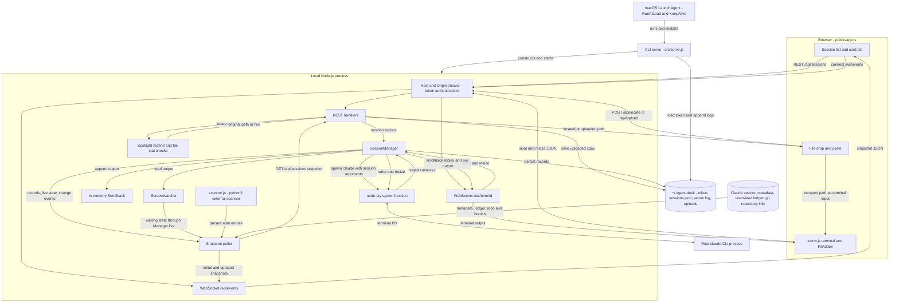

# Architecture

Agent Desk is a local Node.js server and a browser UI. `src/serve.js` creates the token, loads the native pty spawn function, constructs `SessionManager`, starts the snapshot poller, and creates the HTTP and WebSocket server. The server listens on `127.0.0.1`, port 47321 by default.

## Browser and transport

`public/app.js` renders the session list and creates an xterm.js terminal for a selected session. FitAddon fits the terminal to its pane. The UI uses two independent WebSocket paths:

- `/ws/term/<id>` carries JSON input messages (`type: input`, `data`) and resize messages (`type: resize`, `cols`, `rows`) from the browser. The server calls `manager.write` or `manager.resize`. Server messages carry terminal output, with scrollback sent as the first message on every attachment. The browser resets the terminal before replay and suppresses terminal replies during replay.
- `/ws/events` sends `{ type: "snapshot", sessions: [...] }` on connection and whenever the poller publishes a snapshot. The UI updates the list, status labels, header, and notifications. Both connections have browser reconnection logic.

REST handlers in `src/server.js` implement:

| Method and route | Behavior |
| --- | --- |
| `GET /api/sessions` | Return the poller's current snapshot |
| `POST /api/sessions` | Start a named session with directory, optional agent, and brief |
| `PATCH /api/sessions/<id>` | Change the session goal |
| `POST /api/sessions/<id>/stop` | Send SIGTERM to the live pty |
| `POST /api/sessions/<id>/resume` | Spawn Claude with the saved Claude session ID |
| `POST /api/sessions/<id>/dismiss` | Remove an ended session's record and in-memory buffers |
| `POST /api/locate` | Run Spotlight `mdfind -name`, then match file name, size, and modification time within two seconds; return the sole match, or null if absent or ambiguous |
| `POST /api/upload?session=<id>` | Require a known session, accept a nonempty file up to 50 MB, sanitize its name, and save a private copy |

For file drop or paste, the browser first tries locate, then uploads if no original is found. It sends the returned path, escaped for terminal input, over the terminal WebSocket. These endpoints do not themselves send the path to the pty. Uploads remain on disk until removed outside the app.

## Request boundary

HTTP requests and WebSocket upgrades must have a Host of `127.0.0.1:<bound-port>` or `localhost:<bound-port>`. If Origin is present, it must be the matching local HTTP origin on that port. An absent Origin is accepted for CLI clients.

All routes, including static assets and both WebSocket upgrades, require the installation token through the `key` query parameter, `ad_key` cookie, or Bearer header, except `GET /api/health`. Health still requires the Host and Origin checks. An unauthenticated `GET /` returns a sign-in instruction page with status 401.

A valid query token on an HTTP request sets an HttpOnly, SameSite=Strict cookie. `GET /?key=...` redirects to `/` to remove the key from the URL. Token comparisons use `timingSafeEqual` after checking lengths. This is a single local installation token, not a per-user account system.

## Sessions and status

`src/pty.js` loads `node-pty`, ensures packaged spawn helpers have an executable bit when possible, and returns its real spawn function. `SessionManager` receives that function and starts `claude` in the requested working directory with terminal environment variables. New sessions pass a name, optional agent, and brief; resume passes `--resume` with the stored Claude session ID.

Each live session owns a pty and `ScreenWatcher`. Output is appended to a bounded scrollback buffer, fed to the watcher, and forwarded to attached terminal listeners. The watcher detects prompts, bells, and notification escape sequences. User input clears its waiting signals; terminal reports alone do not count as user input.

`src/snapshot.js` combines manager records and live waiting state with Claude session metadata, external scanner results, the team-lead ledger, and git repository information. It computes and sorts the views shown in the list. The poller runs every three seconds by default, prevents overlapping polls, and rebuilds immediately on manager changes using cached scan and ledger data. Discovered Claude session IDs are saved through the manager.

`src/scanner.js` invokes `python3 -I` on `~/.claude/skills/team-lead/scripts/scan_sessions.py`, with a timeout, and parses JSON object lines. A failed or missing scanner produces an empty scan. This optional script is external to the repository.

## Memory and disk

`AGENT_DESK_HOME` overrides the default `~/.agent-desk` directory.

| Location | Contents and lifetime |
| --- | --- |
| In-memory `Scrollback` per session | Most recent 1,000,000 bytes of terminal output; replayed on attachment, lost on server restart |
| `~/.agent-desk/sessions.json` | Session records, including goals and discovered Claude session IDs; written using a temporary file and rename |
| `~/.agent-desk/token` | Installation authentication token, mode 0600 |
| `~/.agent-desk/server.log` | Startup, error, and session mutation logs |
| `~/.agent-desk/uploads/` | Uploaded copies with randomized sanitized names, files mode 0600 |

There are no scrollback files under `~/.agent-desk`. On startup, saved sessions are loaded as ended records with no live pid; eligible records can be resumed by starting a new Claude process. The process handles and scrollback are not restored from disk. Claude metadata under `~/.claude/sessions` and the ledger under `~/.claude/team-lead/ledger.jsonl` are separate inputs, not Agent Desk session-state files.

## Login startup

`install-login` in the CLI calls `src/launchd.js`. It writes `~/Library/LaunchAgents/com.agent-desk.server.plist`, links the CLI into `~/.claude/bin`, and loads the LaunchAgent with `launchctl`. The plist runs the resolved Node executable with the CLI's `serve` command, sets RunAtLoad and KeepAlive, and sends stdout and stderr to the server log. launchd keeps the server process running; it does not restore pty processes or in-memory scrollback after a restart.

`uninstall-login` unloads the LaunchAgent and removes its plist. The CLI link and local data remain. Independently of the LaunchAgent, `open` can start a detached server when health is unavailable. `serve` handles SIGINT and SIGTERM by stopping the poller and closing the server and WebSockets before exiting.
